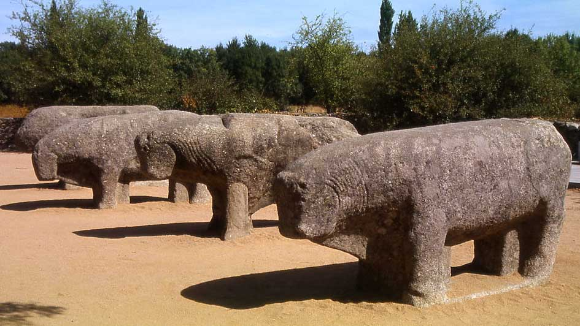

# Site redesign plan

Notes on moving this site off the al-folio template to a minimal Markdown site.
Written for me and for whichever LLM I'm using in VS Code.

## The decision

- **Drop al-folio.** It's a heavy Jekyll theme: around 360 files, a Ruby/Gemfile setup, Docker, GitHub Actions, and a 26 KB `_config.yml`. Most of the maintenance pain comes from the template, not from my content.
- **Keep Markdown.** GitHub Pages has Jekyll built in, so plain `.md` pages plus one small layout build automatically on push. There's no Gemfile, no Docker, no Actions and nothing to install locally.
- **Aim:** a simple personal academic site that an LLM can edit safely. Each change should be a small edit to one text file.

## How this relates to the "plain academic homepage" examples

Sites like David Hogg's (cosmo.nyu.edu/hogg), John Baez's, and university `~user` pages are hand-written HTML files in a `public_html` folder, with no build step. Markdown plus Jekyll produces the same kind of output (plain HTML pages). I just write Markdown, and the header and nav live in one shared layout instead of being copied into every page.

The plain look comes from design choices, not the tool: one column, few fonts, text links as nav, lists instead of cards, no JavaScript.

Bookshelves on those sites are usually plain text lists. They're easy to update (one line per book), fast to load and easy to scan, and they avoid copying publisher cover art. If I ever want covers, Open Library's cover images can be linked by ISBN.

## Target structure

```
_config.yml            ~5 lines: title, markdown: kramdown
_layouts/default.html  one template: <head>, nav, {{ content }}, footer
style.css              all styling (~60–100 lines)
index.md               bio, photo, research interests, papers, links (ORCID, ADS, CV, email)
notes.md               PDF notes/derivations          -> permalink: /notes/
personal.md            contents page linking to the sections below -> /personal/
personal/cabinet.md    cabinet of curiosities (items in _data/gallery.yml) -> /personal/cabinet/
personal/trips.md      trips, one fold-out box each               -> /personal/trips/
personal/blogs.md      blogs I read                               -> /personal/blogs/
books.md               NEW bookshelf / reading log    -> permalink: /books/
cv.md                  link/embed CV PDF              -> permalink: /cv/
404.md
assets/                keep existing img/, pdf/, html/relativity.html
```

Keep the existing URLs (`/`, `/notes/`, `/personal/`, `/cv/`, `/publications/`) working. Either keep the pages, or add a small redirect page for `/publications/` if papers move onto the homepage. `/repositories/` can probably go.

Each page starts with:

```markdown
---
layout: default
title: Books
permalink: /books/
---
```

Images inline:

```markdown

*Iron age (~200BC) sculptures in Ávila, Spain.*
```

Raw HTML is allowed inside `.md` wherever more control is needed (gallery grid, floated photo).

## Content to migrate from al-folio

- `_pages/homepage.md`: subtitle (PhD student, ARI, LJMU), profile photo `assets/img/me.jpeg`, email (obfuscated mailto), ORCID `0009-0004-4738-9022`, ADS link, CV link, and the research interests section.
- `_bibliography/papers.bib`: only 2 entries. Write them as a hand-made list with arXiv/ADS links.
- `_pages/notes.md`: `EnvelopeReprocessingThermal.pdf`, "Tidally disrupted supernova" (no link yet), and `MCP.pdf` (Modern Classical Physics exercises).
- `_data/gallery.yml`: the Cabinet of Curiosities. About 32 images in `assets/img/gallery/` with titles and captions. Convert to Markdown/HTML on `personal.md` (and fix the typos: "monumnets", "soilder", "trianges").
- `_data/blogs.yml`: the blogs I read (Terry Tao, geohot, 4 gravitons, …). Make it a simple list on `personal.md`.
- `assets/pdf/Thomas_Baxter_CV.pdf`, `assets/html/relativity.html`, and the favicon `assets/img/RobinHoodStone.jpg`.
- `googleb5fe69ff7b96ee8c.html` (Google site verification) and `robots.txt`: keep.
- Nothing else from al-folio is needed. The new branch starts empty (see "Building from scratch"), so leave behind `_sass`, `_includes`, `_plugins`, Docker files, Gemfile*, the workflows and the al-folio docs. In the new branch, `CLAUDE.md` should just say "Read REDESIGN.md".

## Taking the old site down

First, save a copy of the al-folio version so nothing is lost:

```bash
git tag al-folio-backup        # marks the current state
git push origin al-folio-backup
```

Then pick one:

- **Unpublish (reversible, recommended):** on GitHub, go to the repo → Settings → Pages. Next to "Your site is live at…", click the `…` menu and choose **Unpublish site**. The site goes offline, but the repo and its content stay untouched. To bring it back, change the publishing settings and push a commit.
- **Delete the repo:** this removes the site and all its history. Only do it if you're sure, and download a backup first.
- Old pages can stay in Google results for a while afterwards. Google Search Console (the repo already has its verification file) has a removals tool if that matters.

You don't actually need to take it down to rebuild. You can build the new version on a separate branch and switch the Pages source over when it's ready. Unpublishing is just the cleaner option if you'd rather nothing is live while you start again.

## Previewing locally

- **Steps 1–3 (plain HTML):** in the VS Code terminal, inside the repo folder, run `python3 -m http.server 8000`, then open http://localhost:8000. Refresh the browser after each save, and press Ctrl+C to stop the server. (The VS Code "Live Server" extension does the same thing and auto-refreshes.) Use a server rather than double-clicking the file, because links like `/style.css` don't work when the page is opened straight from disk.
- **Step 4 onwards (Jekyll):** you need Ruby and Jekyll installed once (`gem install jekyll`). Then run `jekyll serve` and open http://localhost:4000. It rebuilds automatically on every save. Add `_site/` to `.gitignore`, since that's Jekyll's output folder.

## Building from scratch, one step at a time

The goal is to understand every file. Add one idea at a time, and only add something when its absence starts to hurt.

**Step 0: a clean, empty branch**

```bash
git checkout --orphan minimal   # new branch with no files and no history
git rm -rf .                    # empty the working folder (old site is safe on main + the tag)
```

**Step 1: one HTML file**

- Create `index.html` with just a heading and a paragraph about me.
- Add an empty file called `.nojekyll`, which tells GitHub to serve files as-is, without building.
- Push, then in Settings → Pages set Source to **Deploy from a branch**, branch `minimal`, folder `/ (root)`. Visit TomCBaxter.github.io.
- Lesson: a website is just files that a server sends to a browser.

**Step 2: add `style.css`**

- Link it from `index.html` with `<link rel="stylesheet" href="/style.css">`.
- Set the background, text colour, font and column width.
- Lesson: HTML is the content, CSS is the look.

**Step 3: add images and a second page**

- Make an `assets/img/` folder and copy over `me.jpeg` and a few gallery images. Show them with ``.
- Add `personal/index.html` (that folder layout gives the URL `/personal/`).
- You'll need to copy the nav links into both pages. Notice that this is annoying: it's the problem Jekyll solves.

**Step 4: switch on Jekyll, for Markdown and a shared layout**

- Delete `.nojekyll`.
- Add `_layouts/default.html`, holding the `<head>`, nav and footer once, with `{{ content }}` where each page's text goes.
- Rename pages to `.md` with a front-matter header (`layout: default`, `title`, `permalink`), and write them in Markdown.
- Lesson: Jekyll is just "Markdown to HTML, wrapped in my layout". That's all I'm using it for.

**Step 5: add content pages one at a time**

- Add `notes.md`, then `books.md`, then the papers on `index.md`, then `cv.md`. Copy text, PDFs and images over from the al-folio version (tag `al-folio-backup`) as needed.

**Step 6: design**

- Work on the Koberlein-style CSS below, one rule at a time.

Day to day after that: edit a `.md` in VS Code, check the Markdown preview, push. GitHub rebuilds within a minute or so. Running `jekyll serve` locally is optional.

Rules for the LLM in VS Code: keep it to plain HTML, CSS and Markdown with a single layout. Don't add themes, plugins, JavaScript, Gemfiles or build tools unless I ask. Explain any new file before creating it.

## Design direction

Inspired by Brian Koberlein's archive page: https://briankoberlein.com/archive/

What makes it work:

- **Warm dark background**, not pure black: `#1e0e0b`
- **Parchment text** `#b4aa9a`; links slightly brighter `#dacbad`, no underline
- **Classical serif, light weight**. He uses Hoefler Titling (a paid font). Free near-equivalents from Google Fonts: *Cormorant Garamond* or *EB Garamond* for text, and *Cinzel* for spaced capitals in headings and nav.
- **One accent colour used sparingly**: red (~`#ff3333` or a softer `#c0392b`) for a short rule under the page title, the lines either side of the year headings, and small-caps sans labels (e.g. month or category).
- **Big spaced-out uppercase titles** ("ARCHIVE") and an uppercase letter-spaced "HOME" nav link.
- **Table-of-contents style lists**: title, then a faint dotted leader, then an italic date or author on the right.
- **Single centred column** of about 900px, generous spacing, no images in lists, no sidebar.

Works well for: the bookshelf (grouped by year, title … author), the papers list, and the notes list.

Dotted leaders on plain Markdown lists:

```markdown
## 2026
- [Modern Classical Physics](link) *Thorne & Blandford*
```

```css
li { display: flex; align-items: baseline; }
li a { order: 1; }
li em { order: 3; font-style: italic; }
li::after { content: ""; order: 2; flex: 1; border-bottom: 1px dotted #5a4a40; margin: 0 .5em; }
```

## Colour rules (chosen palette: Old parchment + walnut)

The site uses Koberlein's typography and layout on a light parchment background instead of his dark one. It looks the same in light and dark mode. All colours live in section 1 of `style.css`, named by their job:

| Variable | Colour | Job |
|---|---|---|
| `--bg` | `#f2e8d5` parchment | page background |
| `--text` | `#3a2e24` walnut ink | body text |
| `--title` | `#2a1f16` dark brown | headings, links |
| `--muted` | `#6a5c4e` | nav, captions, dates |
| `--accent` | `#5c3d2e` walnut | heading lines, subtitle rule, link hover |
| `--rule` | `#c2ad88` tan | dotted leaders, link underlines |
| `--star` | `#8b3a2b` oxblood | favourites (★) only |

Spare accents for later, all readable on parchment: olive `#5f6b2e`, slate blue `#3d5a73`, ochre `#7a5912`, forest `#3f5e3a`, plum `#6b3a5a`.

Rules for adding colours:

1. Name a variable by its job (`--tag-physics`), never its hue (`--blue`).
2. One main accent plus at most 2–3 extras, each with one fixed meaning.
3. Pick from the spare family above: earthy, slightly greyed, similarly dark.
4. Text colours need a contrast ratio of at least 4.5 against `#f2e8d5`.
5. Never rely on colour alone: pair it with a symbol or a word (★, a label).
6. Only add a colour when a page actually needs it, and record it in this table.

## Gallery (Cabinet of Curiosities)

- The items live in `_data/gallery.yml`, one block each (`image`, `title`, optional `caption` in Markdown). `personal.md` loops over that list, so the page itself never needs editing.
- To add one, drop the image into `assets/img/gallery/` and add a block to `gallery.yml`. Any size or shape works: the masonry columns lay it out automatically.
- Lines starting with `#` in `gallery.yml` are private notes and never published.
- Housekeeping (optional, now and then): shrink oversized images with macOS's built-in `sips`, e.g. `sips -Z 1600 assets/img/gallery/big_photo.jpg` (max 1600 px on the long side). Save photos as JPEG, not PNG.

## Bookshelf conventions (books.md)

- Group by year, newest first.
- One line per book: title (linked if useful), then *author* on the right.
- Mark favourites with ★. Optional short note after an em dash.
- Sections like "Currently reading" and "Up next" at the top are optional.

## Reference sites

- David W. Hogg: https://cosmo.nyu.edu/hogg/ (bare HTML; research diary blog)
- Brian Koberlein: https://briankoberlein.com/ (personal journal kept separate from the science blog)
- Spencer Peters' bookshelf: https://www.cs.cornell.edu/~speters/bookshelf (text nav; Recent / Up Next / Fiction / Nonfiction; asterisks for favourites)
- Patrick Collison's bookshelf: https://patrickcollison.com/bookshelf (the one everyone copies)
- Cosma Shalizi: https://bactra.org/ (plain HTML notebooks and book reviews)
- John Baez: https://math.ucr.edu/home/baez/ (big, entirely plain HTML)
- Richard Exstrom's books read: https://exstrom.com/richard/booksread.html (dated reading log with short reviews)
- The Astrophysics Spectator: https://astrophysicsspectator.org/books (astrophysicist's book reviews)
