## Cabinet of Curiosities

<!-- To add an item: copy one <figure>…</figure> block, then change the image path, alt text, title and caption.
     Images live in assets/img/gallery/. -->

      <figure>
        <a href="/assets/img/gallery/UKscheduledMonuments.jpeg">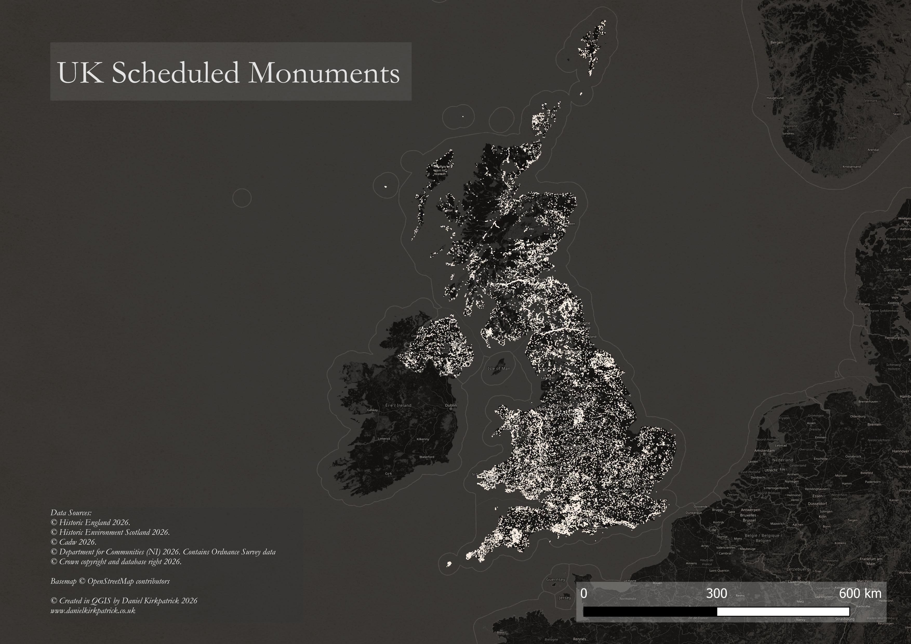</a>
        <figcaption>
          <strong>UK scheduled monuments</strong>
          Historic England map of scheduled monuments in the UK. The lines near the England–Scotland border and further north are Hadrian's Wall (begun ~120 AD) and the Antonine Wall (begun ~142 AD) respectively. The sparse spot in East Anglia roughly marks out "The Fens". Nowadays this is reclaimed land, due to draining, but historically it would have been marshland.
        </figcaption>
      </figure>

      <figure>
        <a href="/assets/img/gallery/skillSpecs_clawer.jpeg">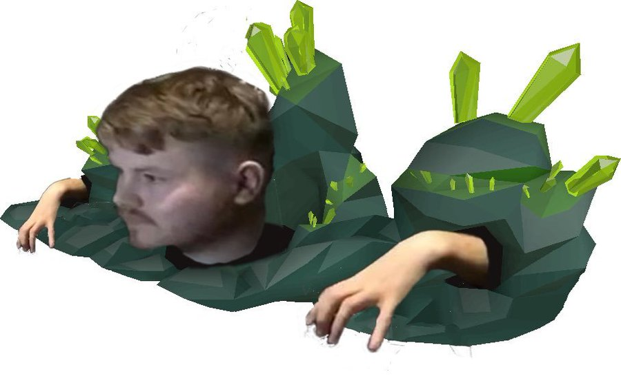</a>
        <figcaption>
          <strong>The claw</strong>
          OSRS creator skill specs has a unique (and painful) F-key grip.
        </figcaption>
      </figure>

      <figure>
        <a href="/assets/img/gallery/unknown_warrior.jpg">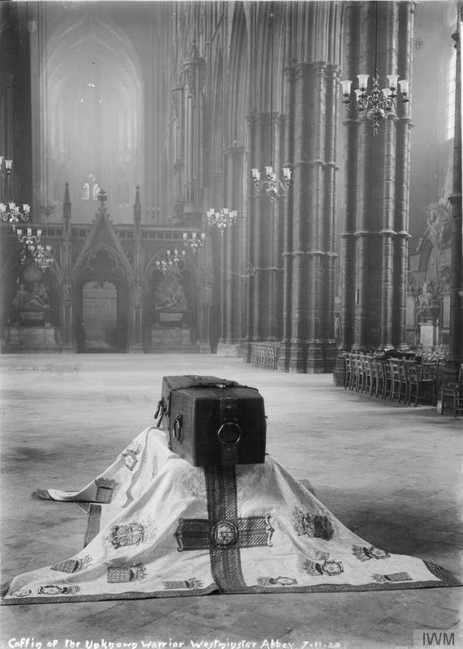</a>
        <figcaption>
          <strong>The Unknown Warrior (1920)</strong>
          Coffin of an unidentified British soldier killed in WW1, at Westminster Abbey. Buried with soil from the various battlegrounds of the war. Symbolic of all (or just unidentified?) fallen soldiers in WW1.
        </figcaption>
      </figure>

      <figure>
        
        <figcaption>
          <strong>Booster recovery</strong>
          Starship Super Heavy booster being recovered.
        </figcaption>
      </figure>

      <figure>
        <a href="/assets/img/gallery/diminishingReturns.jpeg">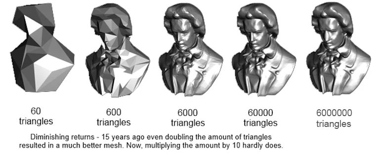</a>
        <figcaption>
          <strong>Diminishing returns</strong>
          The PS1-era Lara Croft 3D model has around 500 triangles, for reference.
        </figcaption>
      </figure>

      <figure>
        <a href="/assets/img/gallery/Toros_de_Guisando.jpg">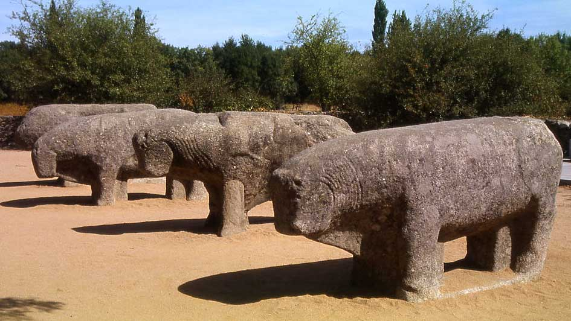</a>
        <figcaption>
          <strong>Toros de Guisando</strong>
          Iron Age (~200 BC) sculptures in the modern province of Ávila, west-central Spain.
        </figcaption>
      </figure>

      <figure>
        <a href="/assets/img/gallery/taq_kasra.jpg">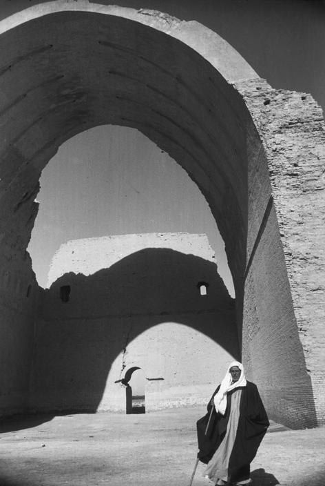</a>
        <figcaption>
          <strong>Tāq Kasrā (1950)</strong>
          Ruins of the only visible structure (~200–500 AD?) in the capital city of the Parthian and Sassanian empires, in modern-day Iraq.
        </figcaption>
      </figure>

      <figure>
        <a href="/assets/img/gallery/tongue-protruding.webp">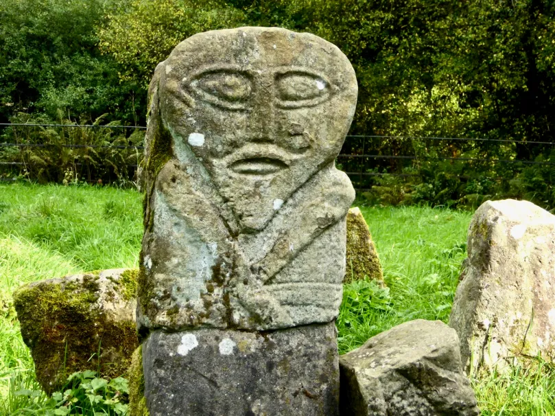</a>
        <figcaption>
          <strong>Boa Island figures</strong>
          Two stone carvings, resembling pagan gods, at a (later) ancient Christian graveyard on Boa Island, County Fermanagh, Ireland. The magic of the place is shown in the <a href="https://www.youtube.com/watch?v=DSpoPBb8LAg">video</a> of Seamus Heaney reciting his poem <a href="https://www.carrowkeel.com/sites/misc/boa.html">'January God'</a> while passing through the fog-filled graveyard hosting the figures.
        </figcaption>
      </figure>

      <figure>
        <a href="/assets/img/gallery/Custom_House.png">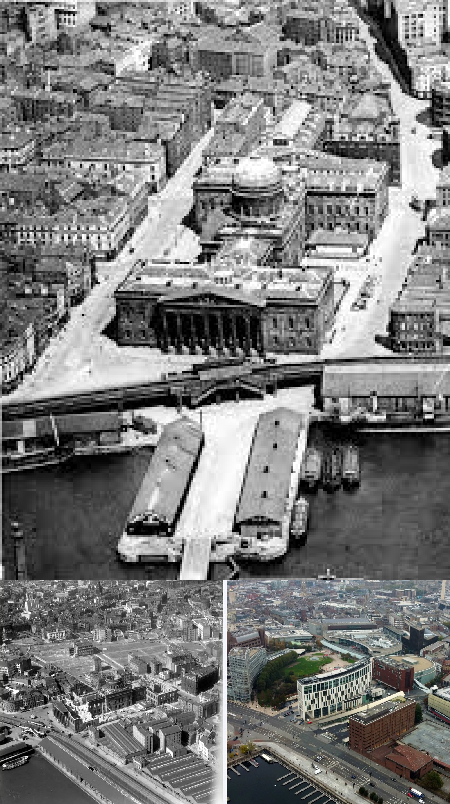</a>
        <figcaption>
          <strong>Liverpool Custom House</strong>
          Top: the Custom House (1954). Bottom left: after the WW2 Blitz. Bottom right: modern Liverpool ONE. Originally built (c. 1839) on the site of the old dock and demolished in 1948 following damage from the Liverpool Blitz. The Liverpool Overhead Railway in front, known colloquially as the "Dockers' Umbrella", was also sadly demolished.
        </figcaption>
      </figure>

      <figure>
        <a href="/assets/img/gallery/rodney_pontins.jpeg">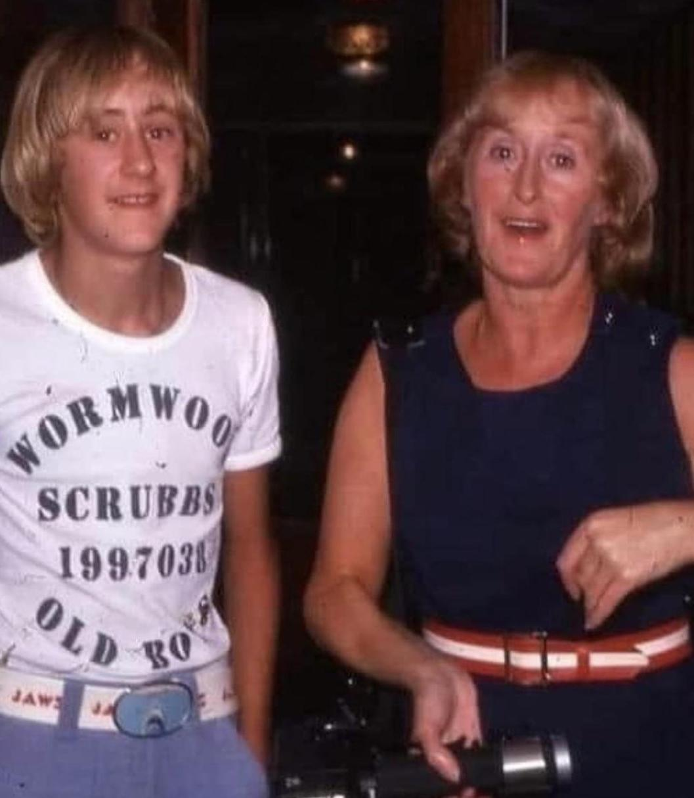</a>
        <figcaption>
          <strong>Nicholas Lyndhurst (Rodney Trotter) in Pontins with his Mum (1976)</strong>
          I would imagine this is shortly after being forced to perform the 1970s equivalent of the cha-cha slide on an empty dancefloor by his mother.
        </figcaption>
      </figure>

      <figure>
        <a href="/assets/img/gallery/job_search.jpeg">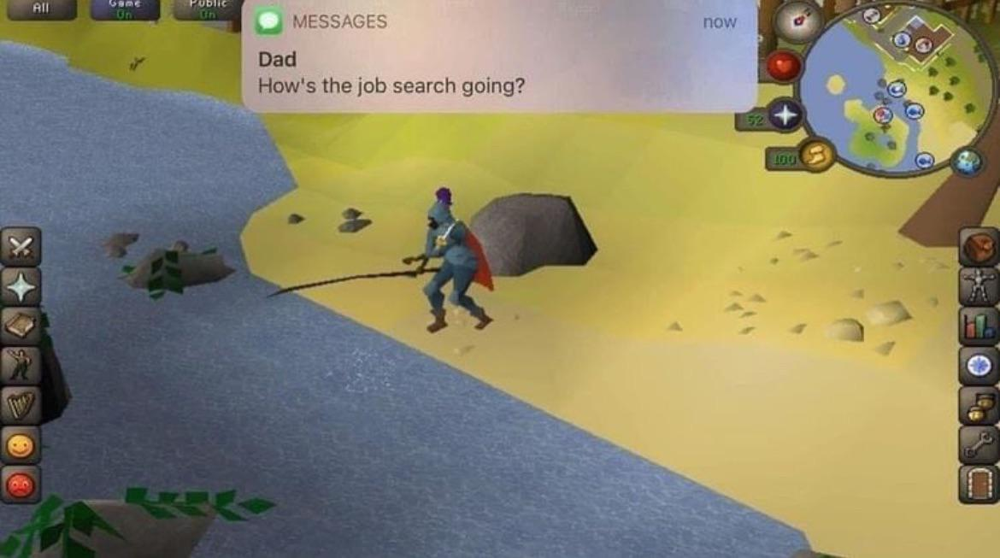</a>
        <figcaption>
          <strong>How's the postdoc search going?</strong>
        </figcaption>
      </figure>

      <figure>
        <a href="/assets/img/gallery/rochdale_town_hall.webp">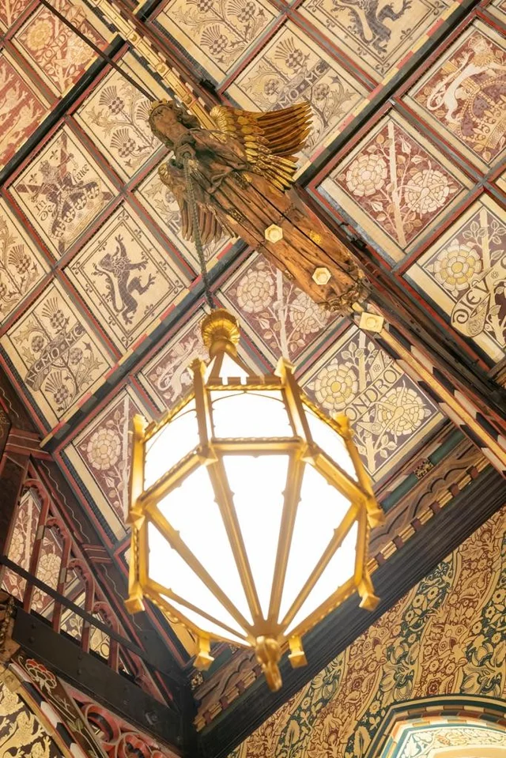</a>
        <figcaption>
          <strong>Detail of Rochdale Town Hall (c. 1871) interior</strong>
          There was a story I heard (it turned out to be a folktale) that Hitler liked this building so much that, if Operation Sea Lion had succeeded, it was to be moved brick by brick to Germany.
        </figcaption>
      </figure>

      <figure>
        
        <figcaption>
          <strong>Steven Gerrard's Lacoste beast (1998?)</strong>
          Steven Gerrard visiting his old school, Cardinal Heenan in West Derby, Liverpool. The highlight of course is the Lacoste pullover and the skinheads in the back. A few more lovely pieces:
          <a href="/assets/img/gallery/lacoste/1.webp">1</a>,
          <a href="/assets/img/gallery/lacoste/2.jpg">2</a>,
          <a href="/assets/img/gallery/lacoste/3.webp">3</a>,
          <a href="/assets/img/gallery/lacoste/4.webp">4</a>.
        </figcaption>
      </figure>

      <figure>
        
        <figcaption>
          <strong>Sunday best</strong>
          Rocking up to your Nan's on Easter in these.
        </figcaption>
      </figure>

      <figure>
        <a href="/assets/img/gallery/exchange_building_1970.png">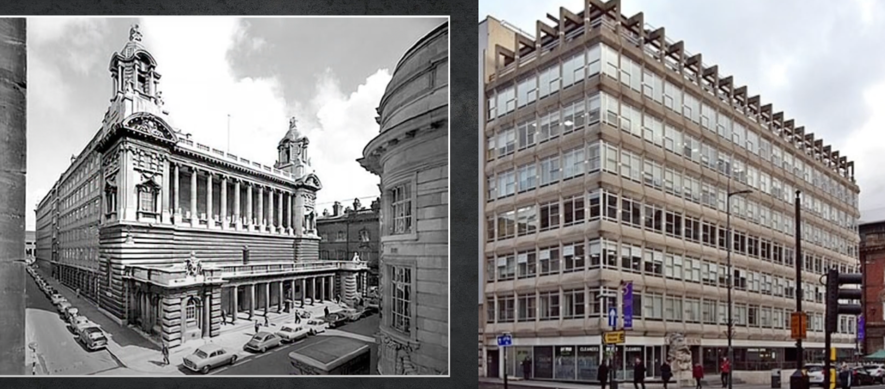</a>
        <figcaption>
          <strong>Exchange Building façade, old (1970) and new</strong>
          This is not a modern = bad argument. In isolation the new one isn't too bad, more open for offices and so on… Simply, which one would you rather walk past on your way to work each day?
        </figcaption>
      </figure>

      <figure>
        <a href="/assets/img/gallery/star_carr_mask.jpg">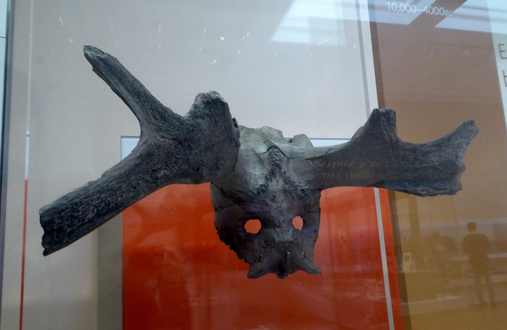</a>
        <figcaption>
          <strong>Star Carr antler mask (British Museum)</strong>
        </figcaption>
        Draft note to self (not published): 1) age of them 2) connection/continuation of ritualistic use -> folkloric tradition with the church dancing (somewhere in Yorkshire?)
      </figure>

      <figure>
        <a href="/assets/img/gallery/thelads.jpeg">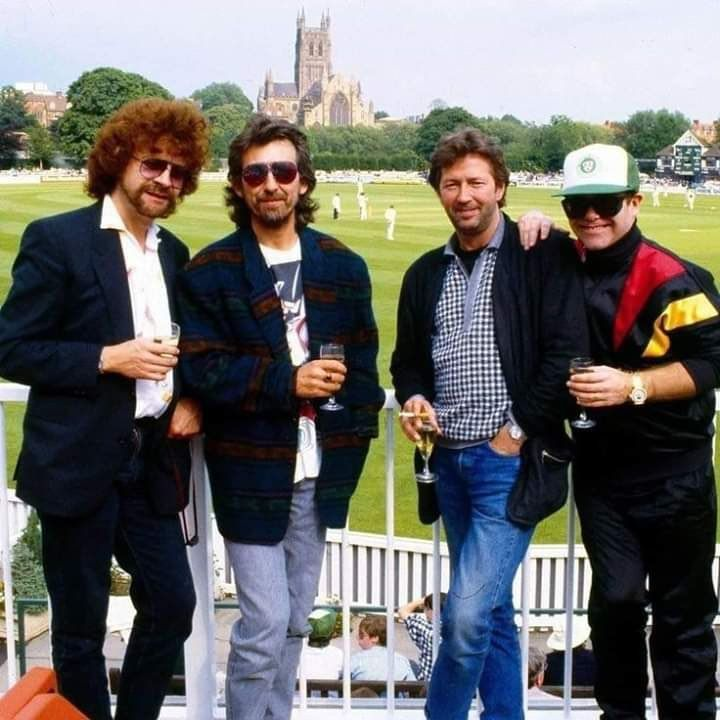</a>
        <figcaption>
          <strong>The lads</strong>
        </figcaption>
        Draft note to self (not published): From left to right: ...
      </figure>

      <figure>
        <a href="/assets/img/gallery/halsall_canal_sculpture.jpg">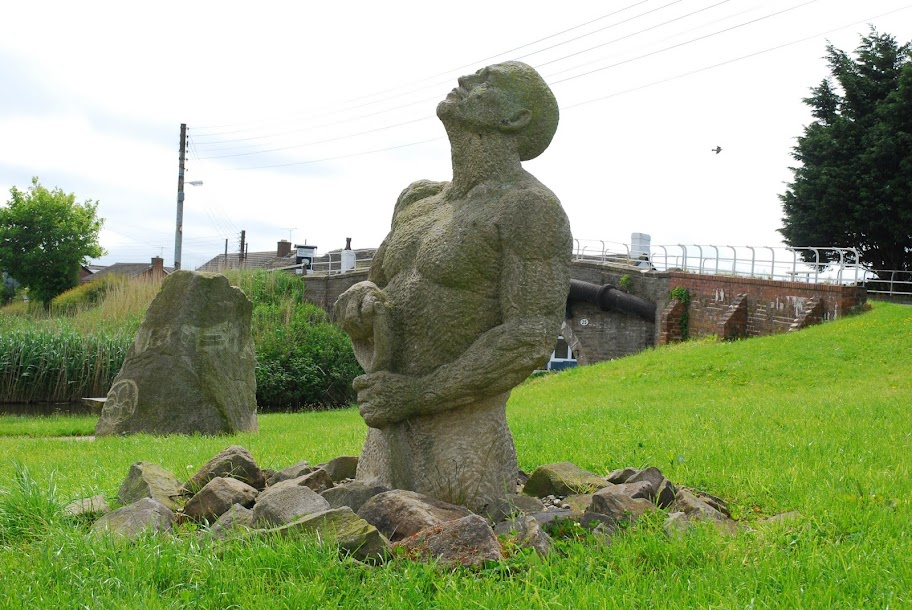</a>
        <figcaption>
          <strong>Halsall canal sculpture</strong>
        </figcaption>
        Draft note to self (not published): bit of history of that particular cutting
      </figure>

      <figure>
        <a href="/assets/img/gallery/pieta_hallwyl.jpg">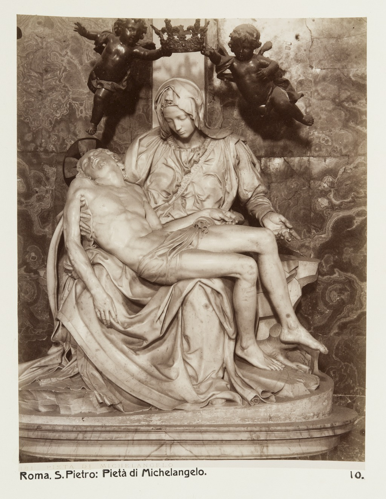</a>
        <figcaption>
          <strong>Pietà (Hallwyl Museum)</strong>
        </figcaption>
        Draft note to self (not published): Find painting from Walker where this is in the background... I really like the idea of objects of significance in the background of images or scenes.
      </figure>

      <figure>
        <a href="/assets/img/gallery/fayum_portrait.jpg">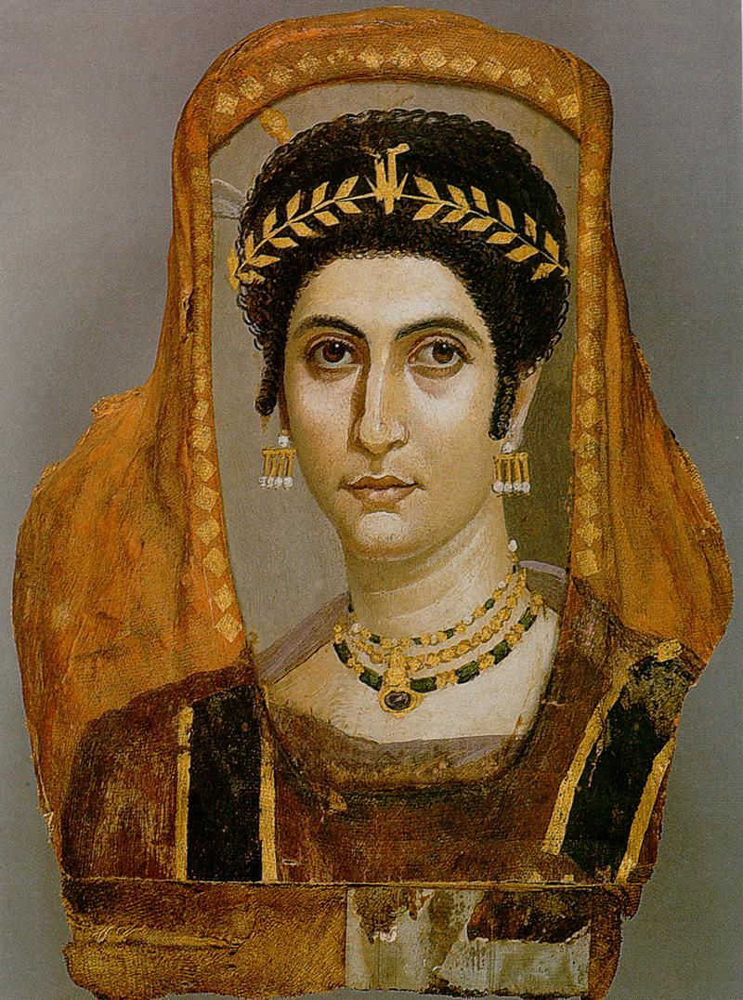</a>
        <figcaption>
          <strong>Fayum mummy portrait</strong>
        </figcaption>
      </figure>

      <figure>
        <a href="/assets/img/gallery/san_miguel_de_lillo.jpg">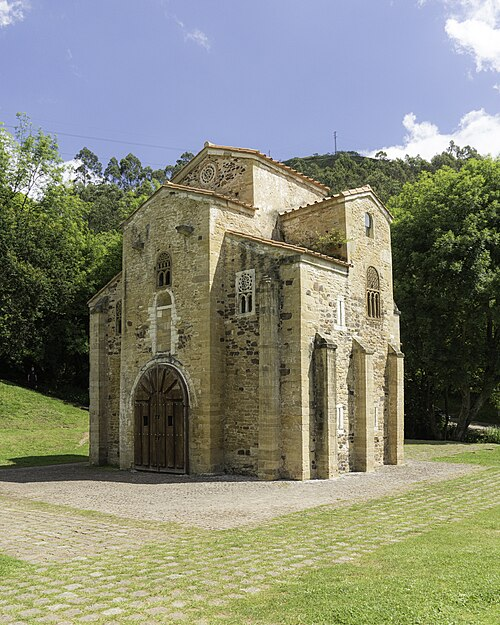</a>
        <figcaption>
          <strong>Iglesia de San Miguel de Lillo</strong>
        </figcaption>
      </figure>

      <figure>
        <a href="/assets/img/gallery/grundtvig_church.jpg">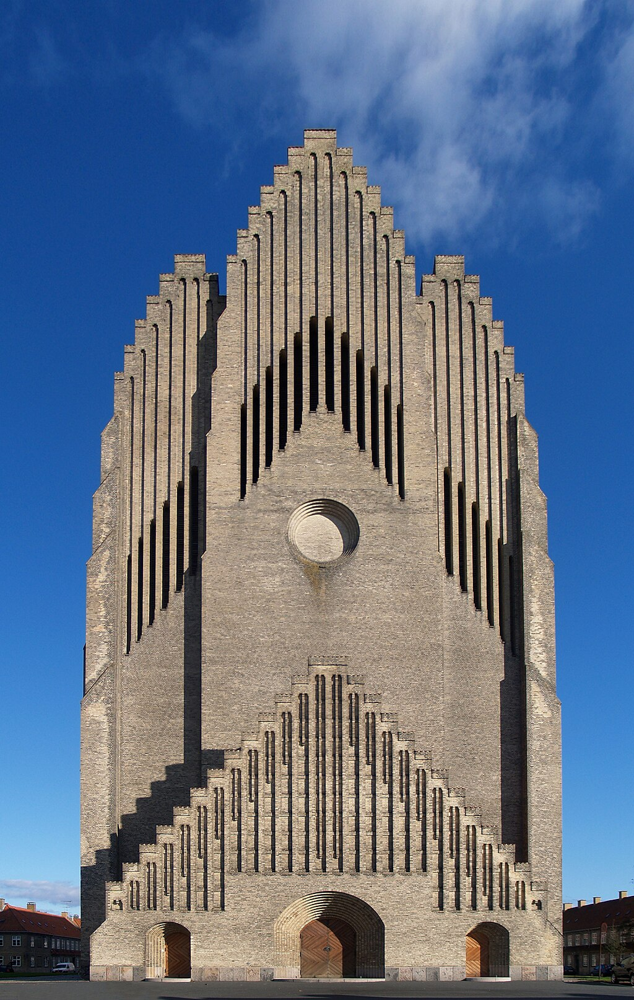</a>
        <figcaption>
          <strong>Grundtvig's Church (P. V. Jensen-Klint, 1913–1940)</strong>
        </figcaption>
      </figure>

      <figure>
        <a href="/assets/img/gallery/sis_building.jpg">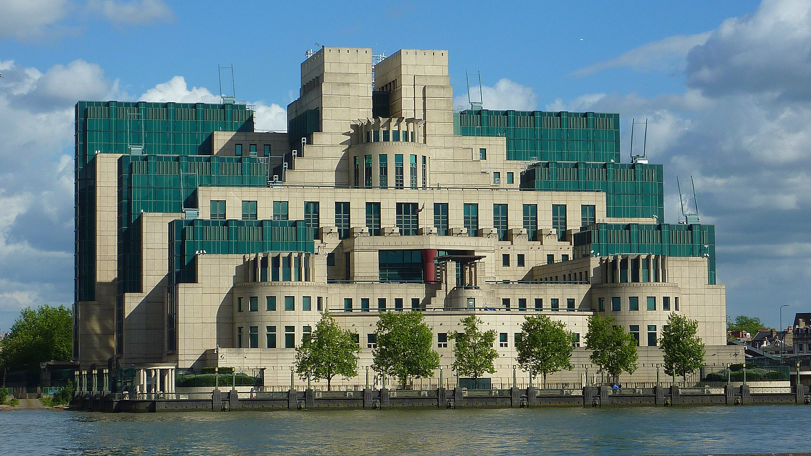</a>
        <figcaption>
          <strong>SIS Building, Vauxhall Cross</strong>
        </figcaption>
      </figure>

      <figure>
        <a href="/assets/img/gallery/pencil_bollard.jpg">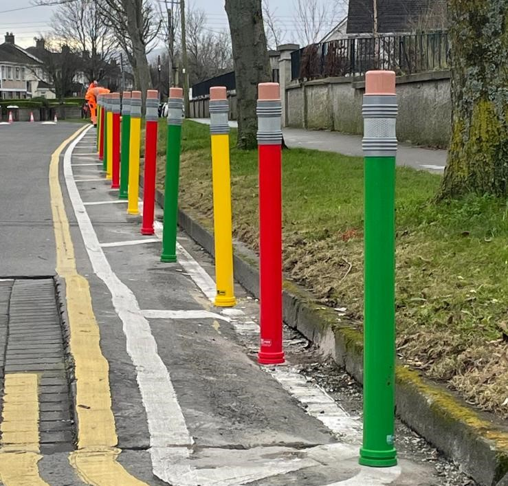</a>
        <figcaption>
          <strong>School pencil bollard</strong>
        </figcaption>
      </figure>

      <figure>
        <a href="/assets/img/gallery/van_castle.jpg">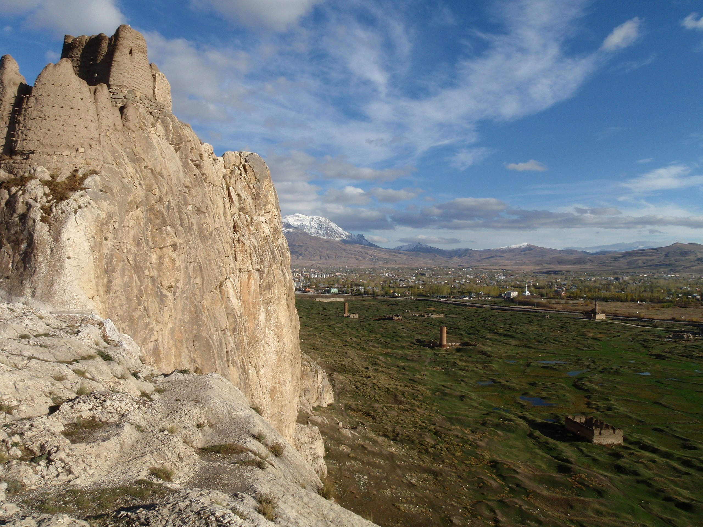</a>
        <figcaption>
          <strong>Van Fortress, Turkey</strong>
        </figcaption>
      </figure>

      <figure>
        <a href="/assets/img/gallery/zelena_hora.jpg">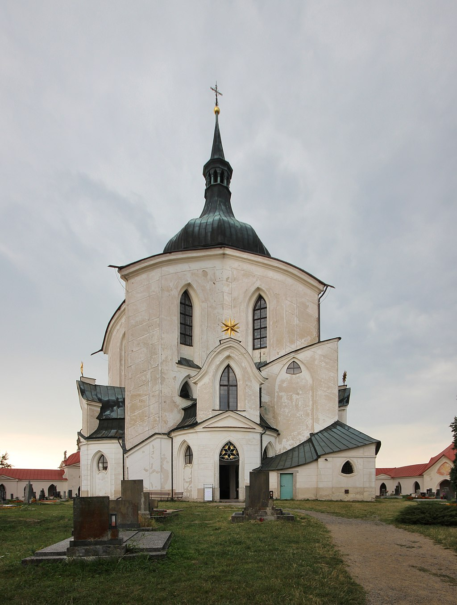</a>
        <figcaption>
          <strong>Zelená hora, Žďár nad Sázavou</strong>
        </figcaption>
      </figure>

      <figure>
        <a href="/assets/img/gallery/rudston_stone.jpg">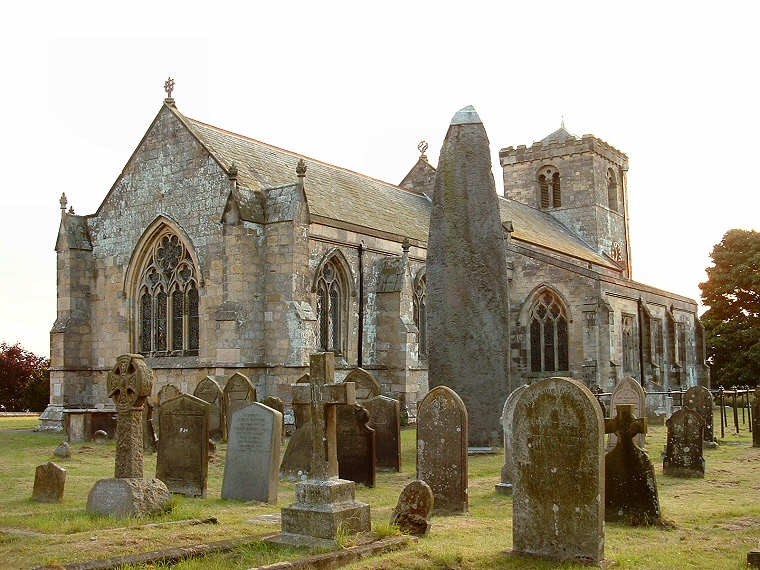</a>
        <figcaption>
          <strong>Rudston church standing stone</strong>
        </figcaption>
      </figure>

      <figure>
        <a href="/assets/img/gallery/bewcastle_cross.jpg">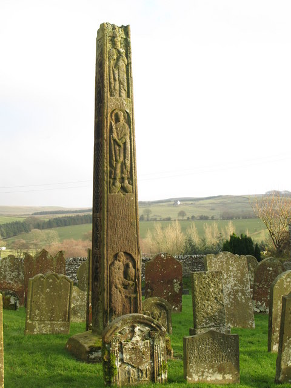</a>
        <figcaption>
          <strong>The Bewcastle Cross (7th century)</strong>
        </figcaption>
      </figure>

      <figure>
        <a href="/assets/img/gallery/polarisation_rubber_band.jpeg">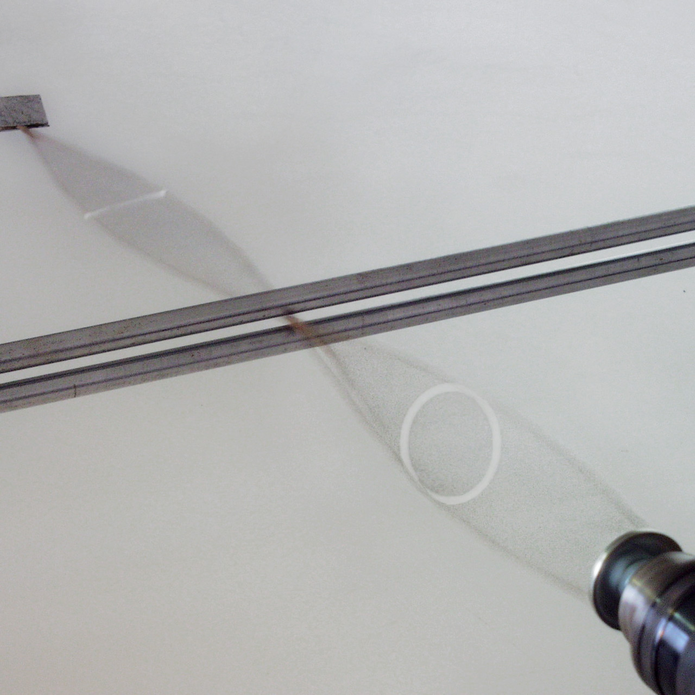</a>
        <figcaption>
          <strong>Polarisation with a rubber band</strong>
        </figcaption>
      </figure>

      <figure>
        
        <figcaption>
          <strong>To care so much</strong>
        </figcaption>
      </figure>

      <figure>
        <a href="/assets/img/gallery/delivery_photo.webp">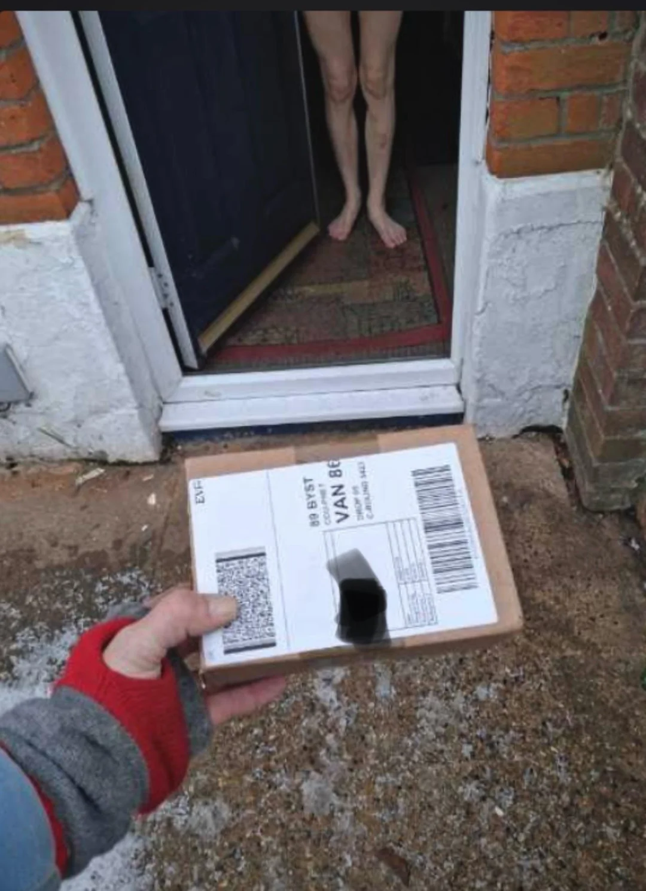</a>
        <figcaption>
          <strong>Delivery photo</strong>
        </figcaption>
      </figure>

## Trips

<!-- One 
 box per trip; it folds open when clicked (plain HTML, no JavaScript).
     Put photos in assets/img/trips/<folder>/ and add an  line for each inside the box. -->

  
Caltech Relativistic Astrophysics Workshop <em>Pasadena, March 2025</em>

  

    <!-- e.g.  -->
  

  
<em>Photos to come.</em>

## Blogs

- [What's new](https://terrytao.wordpress.com/) *Terence Tao*
- [the singularity is nearer](https://geohot.github.io/blog/) *George Hotz*
- [4 gravitons](https://4gravitons.com/) *Matt von Hippel*
- [Natural Intelligence](https://greydanus.github.io/) *Sam Greydanus*
- [Azimuth](https://johncarlosbaez.wordpress.com/) *John Baez*
- [Ran Prieur](https://ranprieur.com/) *Ran Prieur*
- [offlinemark](https://offlinemark.com/) *Mark Mossberg*
- [Shtetl-Optimized](https://scottaaronson.blog/) *Scott Aaronson*
- [Forms of life, forms of mind](https://thoughtforms.life/) *Michael Levin*
